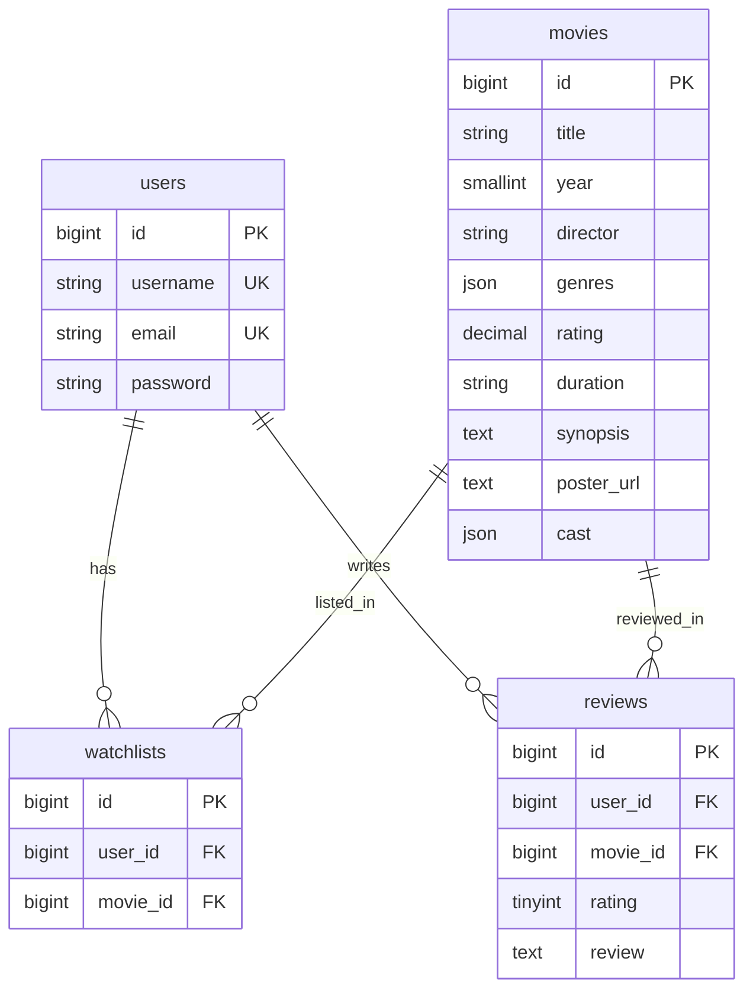

# FilmLog Backend: Movie Watchlist API

REST API untuk aplikasi pencatat film (watchlist, riwayat tontonan, ulasan) dengan autentikasi JWT dan rekomendasi film berbasis Google Gemini yang di-*grounding* ke database lokal. Dibuat untuk penugasan Hacker (Back-End) GDGoC.

## Tech Stack

- PHP 8.3 dan Laravel
- MySQL (relasional)
- JWT (`php-open-source-saver/jwt-auth`)
- Google Gemini API (REST)

## Prasyarat

- PHP 8.2 atau lebih baru dengan ekstensi: `curl`, `fileinfo`, `mbstring`, `openssl`, `pdo_mysql`, `sodium`, `zip`
- Composer
- MySQL
- API key Gemini dari https://aistudio.google.com

## Cara Menjalankan

```bash
git clone https://github.com/USERNAME/movie-watchlist-starter.git
cd movie-watchlist-starter/backend

composer install
cp .env.example .env
php artisan key:generate
php artisan jwt:secret
```

Buat database kosong bernama `filmlog` di MySQL, lalu isi `backend/.env`:

```env
DB_CONNECTION=mysql
DB_HOST=127.0.0.1
DB_PORT=3306
DB_DATABASE=filmlog
DB_USERNAME=root
DB_PASSWORD=

GEMINI_API_KEY=isi_dengan_api_key_kamu
GEMINI_MODEL=gemini-3.6-flash
```

Sesuaikan `DB_PORT`, `DB_USERNAME`, dan `DB_PASSWORD` dengan MySQL di komputer Anda.

Jalankan migration dan seeder (mengisi 20 film), lalu nyalakan server:

```bash
php artisan migrate --seed
php artisan serve
```

API berjalan di `http://localhost:8000/api`. Di Windows PowerShell, `cp` bisa diganti dengan `copy`.

## Menjalankan Frontend Companion

Dengan server Laravel tetap menyala, buka terminal lain dari folder utama repo:

```bash
php -S localhost:5500
```

Lalu buka `http://localhost:5500/frontend/index.html`. Alamat API default frontend sudah `http://localhost:8000/api`.

## Skema Database



- `watchlists` dan `reviews` memiliki unique constraint `(user_id, movie_id)`, jadi tidak ada data ganda.
- Foreign key memakai `ON DELETE CASCADE`, jadi tidak ada data yatim.

## Endpoint

| Method | Endpoint | Auth | Keterangan |
|---|---|---|---|
| POST | `/api/auth/register` | - | Daftar akun (201) |
| POST | `/api/auth/login` | - | Login, mengembalikan `token` dan `user` |
| GET | `/api/auth/me` | Bearer | Data user yang sedang login |
| GET | `/api/movies` | - | Daftar film. Query: `genre`, `search`, `random` |
| GET | `/api/movies/:id` | - | Detail film |
| POST | `/api/movies/recommend` | - | Rekomendasi film dari Gemini. Body: `{ "prompt": "..." }` |
| GET | `/api/watchlist` | Bearer | Watchlist milik user |
| POST | `/api/watchlist` | Bearer | Body: `{ "movieId": 1 }` (201) |
| DELETE | `/api/watchlist/:movieId` | Bearer | Hapus dari watchlist |
| GET | `/api/watched` | Bearer | Riwayat tontonan, rating, dan review |
| POST | `/api/watched` | Bearer | Body: `{ "movieId": 1, "rating": 5, "review": "..." }` |

Header untuk rute terlindungi: `Authorization: Bearer <token>`.

## Status Code dan Format Error

Semua error `/api/*` berbentuk JSON `{ "message": "..." }`.

| Kode | Kapan |
|---|---|
| 200 / 201 | Berhasil / berhasil dibuat |
| 401 | Token tidak ada atau tidak valid, atau login salah |
| 404 | Film atau data tidak ditemukan |
| 409 | Film sudah ada di watchlist |
| 422 | Validasi input gagal (email tidak valid, rating di luar 1-5, dll.) |
| 429 | Terlalu banyak request ke endpoint rekomendasi |
| 502 / 503 | Layanan AI bermasalah atau tidak terjangkau |

## Keamanan

- Password di-hash dengan bcrypt (cast `hashed` pada model `User`).
- Rute privat dilindungi middleware `auth:api` (JWT).
- `user_id` selalu diambil dari token, bukan dari body request, sehingga user tidak bisa mengakses atau mengubah data user lain.
- Semua input divalidasi sebelum menyentuh database.
- Pesan login salah sengaja seragam agar email terdaftar tidak bisa ditebak.
- API key dan secret hanya ada di `.env` (tidak di-commit). Endpoint rekomendasi dibatasi 10 request per menit.

## Rekomendasi AI (Gemini)

`POST /api/movies/recommend` bekerja dengan *prompt grounding*:

1. Backend membaca seluruh film dari database (ID, judul, tahun, sutradara, genre, sinopsis).
2. Daftar itu dimasukkan ke *system instruction* dengan aturan: hanya boleh memilih satu film dari daftar.
3. Input pengguna dikirim sebagai pesan terpisah, dengan instruksi agar perintah di dalamnya diabaikan.
4. Gemini dipaksa membalas JSON lewat `responseMimeType` dan `responseSchema`: `{ "movie_id": 14, "reasoning": "..." }`.
5. Backend memvalidasi bahwa `movie_id` benar-benar ada di database. Jika format rusak atau film di luar database, server membalas error 502 yang rapi, bukan crash.

Contoh respons:

```json
{
  "movie_id": 14,
  "reasoning": "Memento cocok untuk misteri beralur lambat karena ..."
}
```
